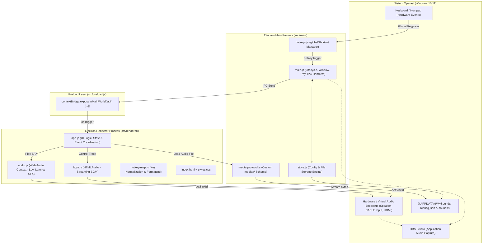

# Product Requirements Document (PRD) — MySounds

**Nama Produk**: MySounds (sebelumnya SoundboardFree)  
**Versi Dokumen**: 1.0.0  
**Status**: Active / Production  
**Target Platform**: Windows 10 / 11 (x64)  
**Tujuan Dokumen**: Menjadi cetak biru arsitektur, spesifikasi fungsional, dan pedoman perbaikan/refactor kode agar pemeliharaan dan ekspansi fitur MySounds di masa depan lebih terstruktur dan efisien.

---

## 1. Ringkasan Produk & Visi (Executive Summary)

**MySounds** adalah aplikasi desktop Windows berorientasi performa tinggi untuk mengelola dan memicu klip audio (soundboard SFX) serta pemutaran musik latar (BGM) secara offline. Dirancang secara spesifik untuk **live streamer**, **gamer**, dan **kreator konten**, MySounds memecahkan masalah umum:
1. **Latensi rendah**: Pemicuan instan melalui global hotkey fisik (seperti Numpad atau tombol fungsi F1–F24).
2. **Isolasi Audio Cerdas**: Kemampuan memisahkan rute output audio BGM ke perangkat virtual/terpisah sehingga musik latar stream tidak terdengar di headphone streamer (memungkinkan streamer mendengarkan musik pribadi tanpa bocor ke OBS).
3. **Kemandirian Penuh (100% Offline)**: Tidak bergantung pada koneksi internet atau layanan cloud, aset suara disimpan secara lokal dan aman.

---

## 2. Target Pengguna & Problem Statement

| Persona | Kebutuhan Utama | Solusi MySounds |
|---|---|---|
| **Streamer Game (OBS Studio)** | Memutar meme/SFX responsif saat live tanpa membuka jendela aplikasi. | Global hotkey aktif saat jendela di latar belakang/tray; integrasi *Application Audio Capture*. |
| **Streamer yang Mendengarkan Musik Pribadi** | Memutar BGM untuk penonton tetapi streamer ingin mendengar Spotify/Discord sendiri tanpa saling bertabrakan. | Dual sink routing: BGM dialihkan ke sink virtual (misal VB-CABLE), soundboard tetap di default speaker. |
| **Kreator Konten & Podcaster** | Menata tata letak tombol soundboard yang rapi, mudah diedit, dan tidak sengaja tergeser saat siaran. | Drag-and-drop kartu slot dengan toggle *Lock Mode* dan kustomisasi kolom grid. |

---

## 3. Arsitektur Sistem & Tech Stack

### 3.1 Tech Stack
- **Desktop Runtime**: Electron 33.x
- **Platform Core**: Node.js (CommonJS untuk Main Process, ES Modules untuk skrip pengujian)
- **Audio Processing**:
  - Web Audio API (`AudioContext`, `AudioBufferSourceNode`, `GainNode`, `AnalyserNode`) untuk SFX.
  - HTML5 Audio (`HTMLMediaElement`) untuk BGM Player.
  - W3C Audio Output Devices API (`setSinkId`).
- **UI / Frontend**: HTML5, Modern CSS3 (CSS Variables, Grid, Flexbox), Vanilla JavaScript (Modular ES6).
- **Packaging & Installer**: `electron-builder` (NSIS Installer x64, Portable Executable).
- **Test Suite**: Node.js Native Test Runner (`node --test`).

### 3.2 Diagram Arsitektur



---

## 4. Spesifikasi Fungsional

### 4.1 Modul Soundboard SFX
- **Multi-Format Import**: Menerima file audio `WAV`, `MP3`, `OGG`, `FLAC`, `M4A`, `AAC`, `OPUS`, `WEBM`. File asli disalin dan dinormalisasi namanya ke `%APPDATA%\MySounds\sounds\`.
- **Slot Properties**:
  - `id`: UUID unik v4.
  - `label`: Nama tampilan (maks 80 karakter).
  - `file`: Path relatif ke direktori suara.
  - `sourceName`: Nama asli file audio saat diimpor.
  - `hotkey`: String accelerator Electron (misal `num1`, `Ctrl+Shift+H`).
  - `volume`: Desimal `0.0` sampai `1.0`.
  - `loop`: Boolean (jika aktif, suara berulang sampai ditekan kembali).
- **Playback Control**:
  - *Polyphony vs Retrigger*: Berdasarkan pengaturan global `retrigger`. Jika aktif, hotkey yang sama memutar ulang suara dari awal (menghentikan voice aktif sebelumnya dengan ramp fade out 20ms).
  - *Stop All*: Pemicu darurat untuk mematikan semua voice yang sedang bermain dengan ramp fade out 40ms.
- **Drag & Drop Layout & Search**:
  - Kartu slot dapat ditukar urutannya secara visual.
  - Fitur **Lock Mode** (ikon gembok): Mencegah kartu bergeser saat live stream dan menstabilkan interaksi slider volume.
  - **Instant Search**: Filter instan soundboard berdasarkan nama sound, sumber file, atau hotkey (dengan shortcut `Ctrl+F`).

### 4.2 Modul Background Music (BGM) Player
- **Dedicated Track**: Memuat 1 file lagu BGM yang dapat diulang (*looping*).
- **Transport Controls**: Play, Pause, Toggle (`Ctrl+F9` default global hotkey), Stop, Seekbar dengan visualisasi timestamp (menit:detik).
- **Dual Output Device Routing**:
  - Output audio BGM dapat diarahkan ke perangkat audio yang berbeda dari Soundboard melalui `HTMLMediaElement.setSinkId()`.
  - **Silent Candidate Detection**: Otomatis mendeteksi perangkat audio bertipe virtual (*CABLE Input*, *VB-Audio*, *Voicemeeter*) atau endpoint HDMI display tanpa speaker.
  - **Peringatan Perangkat Sama**: Menampilkan alert peringatan visual jika BGM diarahkan ke perangkat default (mencegah BGM bocor ke speaker pribadi streamer).
  - **Uji Suara Perangkat (*Tes Device*)**: Mengirim nada beep khusus ke output BGM untuk memvalidasi isolasi audio.

### 4.3 Modul Global Hotkeys & Validasi
- **Electron Global Shortcut Integration**: Mendaftarkan hotkey di level sistem operasi sehingga dapat dipicu saat aplikasi apapun sedang aktif/fokus.
- **Aturan Validasi Hotkey**:
  - Tombol **Numpad** (`Num 0`–`Num 9`, `Num +`, `Num -`, `Num /`, dll) dan **F-Keys** (`F1`–`F24`) diperbolehkan tanpa tombol modifier.
  - Tombol alfanumerik biasa (A–Z, 0–9 pada keyboard utama) **wajib** menggunakan modifier (`Ctrl`, `Alt`, atau `Shift`) untuk mencegah bentrok pengetikan dokumen/game.
  - Mendeteksi bentrokan (*conflict*) antar slot atau aplikasi eksternal.
- **Runtime Hotkey Suspension**: Saat modal *Atur Hotkey* dibuka, seluruh pendaftaran global hotkey ditangguhkan sementara agar proses perekaman tombol tidak memicu suara lain.

### 4.4 Modul Integrasi OBS Studio
- **Application Audio Capture Support**: Dioptimalkan untuk model penangkapan proses di Windows 10/11 (OBS 28+), memungkinkan OBS menangkap output proses `MySounds.exe` secara spesifik.
- **Panduan Terintegrasi**: Dialog langkah demi langkah di dalam aplikasi yang memandu pengguna mengatur OBS dan melakukan tes audio langsung.

### 4.5 Modul Jendela & System Tray
- **Custom Frameless Window**: Titlebar modern terintegrasi dengan tombol Minimize, Maximize/Restore, dan Close.
- **Minimize to System Tray**: Tombol close (X) mengalihkan aplikasi ke System Tray dengan notifikasi sistem.
- **Menu Tray**:
  - Buka / Fokus MySounds.
  - Stop Semua Suara.
  - Keluar (terminasi proses penuh).
- **Flag Performa di Background**:
  - `disable-background-timer-throttling`
  - `disable-renderer-backgrounding`
  - `disable-backgrounding-occluded-windows`
  Menjamin audio dan timer Web Audio tidak tercekik saat jendela terminimize.

### 4.6 Modul Penyimpanan & Manajemen Data (`store.js`)
- **Struktur Direktori**:
  - `%APPDATA%\MySounds\config.json`: Menyimpan metadata slot, setting, volume, kolom, dan hotkey.
  - `%APPDATA%\MySounds\sounds\`: Direktori penyimpanan mandiri untuk semua file audio.
- **Data Integrity & Resiliency**:
  - Validasi dan sanitasi ketat (`sanitizeConfig`, `sanitizeSlot`, `sanitizeBgm`).
  - Pembuatan cadangan otomatis (`config.corrupt.<timestamp>.json`) jika terjadi kegagalan parsing JSON, digantikan dengan konfigurasi default yang aman.
  - Pembersihan file yatim (*orphan cleanup*): File di folder suara yang tidak lagi terasosiasi dengan slot atau BGM otomatis dibersihkan saat konfigurasi disimpan.

---

## 5. Non-Functional Requirements (Kebutuhan Non-Fungsional)

1. **Latensi Audio**:
   - Pemicuan suara soundboard di bawah **15ms** dari saat event hotkey keyboard diterima OS.
2. **Keamanan (Security & CSP)**:
   - `contextIsolation: true`, `nodeIntegration: false`.
   - Content Security Policy (CSP) ketat: Membatasi eksekusi skrip hanya dari sumber lokal (`'self'`).
   - Protokol khusus `media://` memiliki privilege aman dan memeriksa traversal direktori (`..`) sebelum menyajikan file.
3. **Efisiensi Memori & Resource**:
   - Audio buffer untuk slot yang sering dipakai di-*cache* di memori RAM, namun dapat dimuat secara asinkron (*lazy-loaded*) saat aplikasi dijalankan.
   - Analyser audio level meter berhenti melakukan polling animasi saat jendela terminimize atau tidak ada suara aktif.
4. **Portabilitas & Keandalan**:
   - Aplikasi dapat dipindahkan atau didistribusikan sebagai portable executable tunggal tanpa dependensi runtime eksternal.

---

## 6. Struktur Kode & Tanggung Jawab Modul

```text
MySounds/
├── build/
│   ├── icon.ico                     # Ikon multi-resolusi untuk aplikasi Windows
│   └── make-assets.js               # Skrip generator aset ikon biner berbasis kanvas prosedural
├── src/
│   ├── assets/
│   │   └── app.png                  # Aset ikon PNG 256x256
│   ├── main/
│   │   ├── hotkeys.js               # Kelas HotkeyManager: Wrapper globalShortcut Electron
│   │   ├── main.js                  # Entry point Electron: Window, Tray, IPC handlers, flags
│   │   ├── media-protocol.js        # Handler protokol khusus media:// untuk streaming audio lokal
│   │   └── store.js                 # File I/O, sanitasi config, import file, orphan cleanup
│   ├── preload.js                   # Bridge aman exposing window.api ke Renderer Process
│   └── renderer/
│       ├── app.js                   # State manager UI, event handling, modal dialogs, DOM rendering
│       ├── audio.js                 # AudioEngine singleton: Web Audio Context, buffer caching, mixing
│       ├── bgm.js                   # BgmPlayer singleton: Pemutar HTMLAudio BGM dan sink routing
│       ├── hotkey-map.js            # Normalisasi kode tombol keyboard ke accelerator string
│       ├── index.html               # Struktur DOM aplikasi, SVG icons, modal templates
│       └── styles.css               # Desain antarmuka gelap responsif (modern stream deck UI)
├── test/
│   ├── hotkey-map.test.mjs          # Unit test pemetaan tombol dan validasi kombinasi hotkey
│   └── store.test.mjs               # Unit test konfigurasi, penyimpanan, import, dan pembersihan file
├── package.json                     # Konfigurasi dependensi dan skrip build
├── PRD.md                           # Dokumen Persyaratan Produk (PRD) ini
└── README.md                        # Ringkasan proyek publik
```

---

## 7. Rencana Refactoring & Peningkatan Kode (Code Improvement Roadmap)

Berdasarkan analisis arsitektur, berikut adalah area perbaikan yang direkomendasikan untuk pengembangan iteratif selanjutnya:

### 7.1 Dekomposisi `src/renderer/app.js` (Prioritas Tinggi)
- **Kondisi Saat Ini**: Berkas `app.js` memiliki ukuran ~1.100 baris kode yang menangani manipulasi DOM, state management, drag-and-drop, modal dialog, dan listener IPC sekaligus.
- **Rekomendasi Refactor**:
  1. Pecah menjadi modul terpisah:
     - `src/renderer/ui/grid.js` (Logika kartu slot, drag & drop, render kartu).
     - `src/renderer/ui/modals.js` (Manajemen modal Atur Hotkey, Pengaturan, Edit Slot, Panduan).
     - `src/renderer/state.js` (Pusat reactive state dan auto-save debouncing).
     - `src/renderer/device-manager.js` (Penanganan enumerasi audio input/output, sink assignment, dan silent candidate evaluation).

### 7.2 Fitur Playlist / Multi-Track BGM (Prioritas Menengah)
- **Kondisi Saat Ini**: BGM saat ini hanya mendukung 1 file lagu tunggal.
- **Rencana Peningkatan**:
  - Mengubah skema `config.bgm` menjadi array `tracks` dengan mode shuffle, repeat-all, dan auto-next track untuk siaran stream yang panjang.

### 7.3 Soundboard Profile / Pages System (Prioritas Menengah)
- **Kondisi Saat Ini**: Menggunakan 1 board datar dengan jumlah slot fleksibel.
- **Rencana Peningkatan**:
  - Menambahkan fitur Tab Kategori atau Profil (misalnya: *Game Valorant*, *Game Horror*, *Just Chatting*) agar pengguna dapat mengelompokkan bank SFX mereka.

### 7.4 Penambahan TypeScript atau JSDoc Type Checking (Prioritas Rendah)
- **Rencana Peningkatan**:
  - Menambahkan `jsconfig.json` atau migrasi bertahap ke TypeScript untuk memberikan intellisense dan validasi tipe data statis pada objek `Slot`, `Config`, dan `IPCContract`.

---

## 8. Panduan Verifikasi & Quality Assurance

Setiap kali melakukan perubahan kode, lakukan verifikasi menggunakan checklist berikut:
1. **Unit Testing**: Jalankan `npm test` — pastikan seluruh 18+ tes unit pada `hotkey-map` dan `store` lulus (100% pass).
2. **Smoke Test Electron**: Jalankan `npm run smoke` — memastikan jendela, protokol media, Web Audio Context, dan IPC bridge berhasil dimuat tanpa error console level 2+.
3. **Audio Routing**: Uji tombol *Tes Device* pada tab BGM dan *Test Suara* pada modal Panduan OBS.
4. **Clean Code Verification**: Pastikan tidak ada hardcoded path atau variabel lingkungan lama yang tertinggal di dalam repositori.
